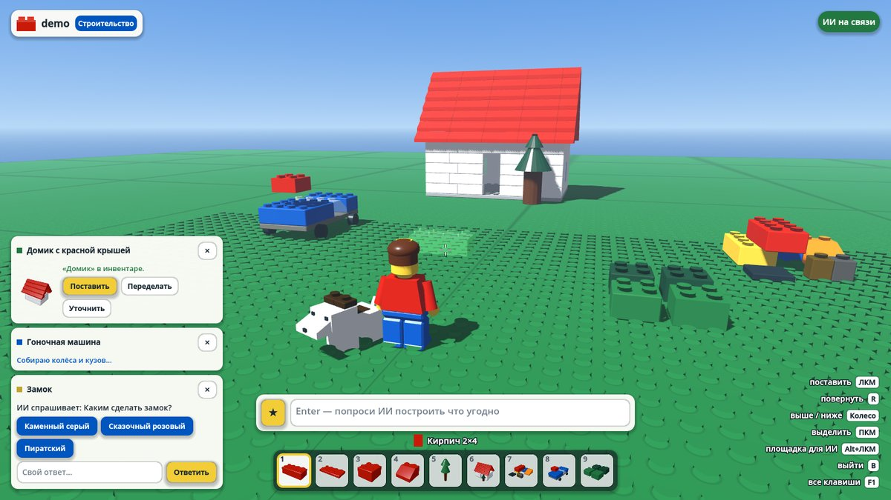
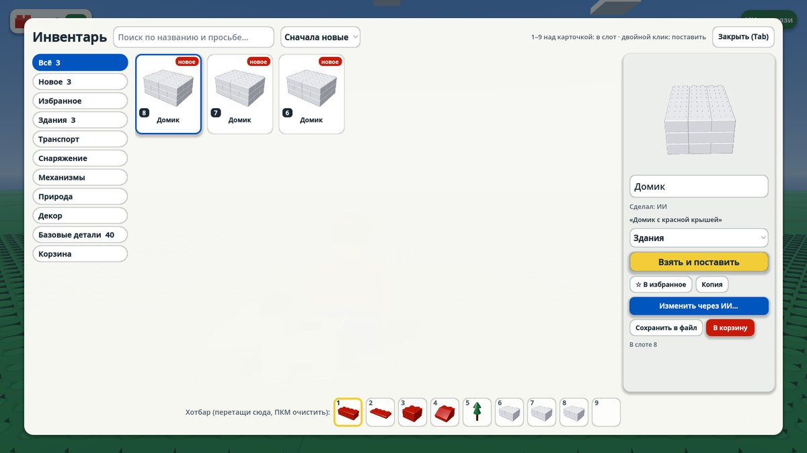

# AI Sandbox World

3D-песочница в стиле конструктора: мир из пластиковых кирпичиков с шипами, где ты строишь что угодно своими руками или просишь своего ИИ-агента (по MCP) построить за тебя. Игра без ограничений: каждый игрок сам создатель своего мира.

## Главное

- **Один мир, один создатель.** У каждого мира ровно один хозяин: строишь в нём только ты и твой ИИ. Миров может быть сколько угодно, они выбираются на стартовом экране. Во втором релизе можно будет приглашать друзей поиграть в свой мир, но не строить.
- **Строй сам.** B включает режим строительства: деталь висит перед прицелом полупрозрачным «призраком» и прилипает к сетке шипов, ЛКМ ставит её.
- **Проси ИИ.** Enter, пишешь «маяк на скале с горящим огнём», агент собирает его из кирпичей, и постройка появляется в инвентаре или сразу на отмеченной площадке.
- **Большой инвентарь** (Tab): до 1000 предметов с картинками, категории, поиск, избранное, корзина. Базовые детали (кирпичи, пластины, плитки, скосы, окна, двери, деревья) есть всегда и красятся в любой цвет.

## Как запустить

1. Скачайте [Godot 4.3](https://godotengine.org/download/archive/4.3-stable/) (обычная версия, не .NET).
2. В Godot нажмите **Import** и выберите файл `project.godot` из этой папки.
3. Нажмите **F5**, создайте мир на стартовом экране.

Новичку игра сама покажет три шага: поставить деталь, открыть инвентарь и попросить ИИ. Все клавиши: **F1**.

## Управление

| Где | Клавиши |
| --- | --- |
| Ходить | WASD, Shift бег, Пробел прыжок, мышь камера, колесо ближе и дальше, **E** сесть в транспорт, надеть или включить |
| Предметы | **1–9** слот, Shift+колесо листать, **F** поставить перед собой, **G** подобрать, **Tab** инвентарь, **C** цвет деталей |
| Строительство (**B**) | ЛКМ поставить, **R** / Shift+R повернуть, колесо выше и ниже на пластину, Ctrl+колесо камера, ПКМ выделить (Shift: ещё), **M** перенести, Ctrl+D копия, Delete удалить, средняя кнопка взять образец в слот, Alt+ЛКМ отметить площадку для ИИ, Alt+ПКМ убрать её, **V** вид сверху |
| ИИ | **Enter** или **/** написать просьбу, Shift+Enter новая строка, ↑ ↓ прошлые просьбы, ★ шаблоны и идеи, **L** журнал, **F2** подключить агента |
| Прочее | Ctrl+Z / Ctrl+Y отменить и вернуть (50 шагов), Esc меню |

Подсказки в правом нижнем углу показывают только то, что работает прямо сейчас.

## ИИ-строитель

Агента нужно подключить один раз: **F2**, кнопка своей программы (Claude Code, Cursor, VS Code, Claude Desktop), вставить скопированное, куда написано. Игра сама работает как MCP-сервер на `http://127.0.0.1:7778/mcp`, ставить ничего не нужно (кроме Node.js для Claude Desktop). Ключ API не нужен: постройки придумывает модель самого агента.

Как написать просьбу:

- Над полем чипы: **что** строим (здание, транспорт, снаряжение, механизм, природа, правила мира) и **размер** (S 8 шипов, M 16, L 32, XL 64).
- **Площадка.** В режиме строительства протяни Alt+ЛКМ прямоугольник на пластине: ИИ построит точно на нём.
- **Изменить готовое.** Выдели постройку ПКМ и нажми Enter: просьба поменяет именно её («сделай крышу синей»). Предмет из инвентаря меняется кнопкой «Изменить через ИИ».
- Карточки слева внизу показывают каждую просьбу: ИИ думает, задал вопрос (кнопки ответов или свой ответ), готово (картинка и кнопки **Поставить**, **Переделать**, **Уточнить**) или не вышло (**Ещё раз**).

Как это работает: MCP-запросы всегда идут от агента к игре, поэтому агент вызывает `wait_for_player_request`, и игра держит запрос открытым, пока ты не напишешь просьбу. Агент собирает объект из кирпичей и отвечает `create_object` или `update_object`, может спросить тебя (`ask_player`) и показать, что делает (`report_progress`). Пока в правом верхнем углу горит «ИИ на связи», агент слушает игру.

Агент описывает постройку кирпичами в шипах и пластинах (`brick`, `plate`, `tile`, `slope`, `round`, `cone`) и крупными командами `box`, `wall` (с окнами и дверями), `roof` и `tower`, которые игра сама раскладывает на кирпичи с перевязкой. Цвета берутся из набора цветов конструктора, поэтому всё, что строит ИИ, выглядит как часть одного мира. Формат и правила для агента: `ai/style_guide.md`, `ai/builder_prompt.md`.

## Механики и физика от ИИ

Попроси не только построить, но и оживить: «велосипед», «самолёт, чтобы летать над миром», «реактивный ранец», «батут», «дверь, которая открывается», «сделай гравитацию как на Луне», «замедли время». Агент описывает механику данными, игра её исполняет:

- **Транспорт** (подойди и нажми E): наземный (W/S газ и тормоз, A/D руль, Пробел прыжок), самолёт (разбег, подъёмная сила, крен) и парящий (вертолёт, метла, ковёр-самолёт). Колёса и пропеллеры крутятся сами.
- **Снаряжение** (E надеть, E ещё раз снять): полёт, планирование, двойной прыжок, быстрый бег, своя гравитация.
- **Предметы**: батуты и ускорители толкают игрока, двери и рычаги включаются по E, мельницы и карусели крутятся.
- **Физика мира**: гравитация, скорость, высота прыжка и скорость времени в твоём мире.

Код от агентов игра не запускает: механика собирается из готовых блоков с настройками, поэтому вариантов много, но всё под контролем игры. Подробности для агентов в `ai/mechanics_guide.md`.

Для продвинутых: отдельный [mcp-server](mcp-server/README.md) на Node.js умеет сам генерировать объекты через Claude API.

## Сохранения

- `user://worlds/<мир>/world.json`: постройки мира, при каждом открытии делается копия (`world.json.1`–`.3`).
- `user://worlds/<мир>/physics.json`: физика мира от ИИ, `thumb.png`: картинка для списка миров.
- `user://inventory.json`: инвентарь, хотбар, шаблоны и история просьб, общие для всех твоих миров.
- `user://settings.json`: фигурка, мышь, звук, графика.

Мир сохраняется сам через полсекунды после изменения, каждую минуту и при выходе. Сохранение первой версии игры (`user://world.json`) само переезжает в мир «Мой первый мир».

## Устройство

- `scripts/world.gd`: стартовый экран или мир: базовая пластина, небо с кирпичными облаками, солнце, игрок, интерфейс.
- `scripts/style.gd`: цвета конструктора, пластиковые материалы, размеры (шип 0,4 м, пластина 0,16 м, кирпич 0,48 м).
- `scripts/bricks.gd`: кирпичи и команды box, wall, roof, tower: проверка, раскладка на кирпичи, меши с шипами и коллизия.
- `scripts/object_builder.gd`: строит объект из описания агента (кирпичи, детали, эффекты, механика).
- `scripts/worlds.gd`: миры, инвентарь и настройки на диске; `scripts/catalog.gd`: категории и базовые детали.
- `scripts/agent_bridge.gd`: постройки мира, инвентарь, хотбар, площадка, выделение, просьбы к ИИ, отмена; команды для агентов и WebSocket на порту 7777 для `mcp-server`.
- `scripts/mcp_http.gd`: MCP-сервер внутри игры на порту 7778.
- `scripts/build_mode.gd`: режим строительства; `scripts/effects.gd`: сборка снизу вверх и рассыпание на кирпичи; `scripts/sfx.gd`: синтезированные звуки.
- `scripts/ui/`: интерфейс: `game_ui.gd` (окна и клавиши), `hotbar.gd`, `prompt_panel.gd` (просьбы к ИИ), `inventory_screen.gd`, `connect_panel.gd` (F2), `pause_menu.gd` (меню, настройки, фигурка), `help_screen.gd`, `color_picker.gd`, `tutorial.gd`, `world_select.gd`, `thumbnails.gd` (картинки предметов), `ui.gd` (общее оформление).
- `scripts/player.gd`, `scripts/minifig.gd`, `scripts/pet.gd`: фигурка игрока с камерой и пёсик из кирпичей.
- `scripts/mechanics/`: механики от ИИ: транспорт, снаряжение, предметы, анимация деталей, физика мира.
- `shaders/`: глянцевый пластик (`plastic*.gdshader`) и базовая пластина с шипами (`baseplate.gdshader`).
- Рендерер GL Compatibility выбран ради стабильности: игра пойдёт даже на слабых видеокартах. Внешние ассеты не нужны.
